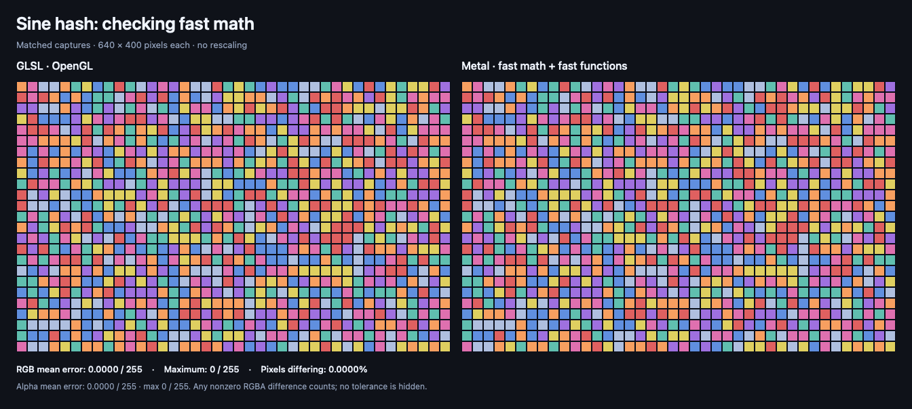

# GLSL → Metal examples

**A little shader inspo, with receipts.**

Explore three visual effects and two small experiments that show where a shader conversion can change the look.

Each comparison shows **GLSL on the left** and **Metal on the right**, rendered at the same size and moment in the animation. The math experiments label the settings and intentional mistakes being compared.

## Pick your vibe

| Example | The look | Try it for |
| --- | --- | --- |
| [Aurora ribbons](aurora-ribbons/) | Soft, flowing bands of color | Ambient backgrounds and welcome screens |
| [Ripple distortion](ripple-distortion/) | An image bending around gentle waves | Playful image treatments |
| [Two-texture blend](two-texture-blend/) | Two images mixing across a moving boundary | Artwork transitions and layered visuals |
| [Negative modulo](negative-modulo/) | A dot pattern that repeats across the center | Catching broken patterns at negative coordinates |
| [Noise hashes](noise-hash/) | A colorful mosaic with a precision plot twist | Checking how math settings change procedural patterns |

## Aurora ribbons

Soft color, slow movement, a little dreamy.

This effect creates its visuals entirely through code, so there’s no background image to supply. You can adjust the palette and motion to fit your app.


[Explore this example →](aurora-ribbons/README.md)

## Ripple distortion

Give an image a little movement.

The wave bends the grid while keeping its colors and details recognizable. The colored corner markers also help reveal whether the image accidentally flipped during conversion.


[Explore this example →](ripple-distortion/README.md)

## Two-texture blend

Two visuals, one flowing transition.

This example blends separate images along a soft, moving boundary. It includes the extra Metal setup needed to work with both images.


[Explore this example →](two-texture-blend/README.md)

## Negative modulo

Same dots, both sides of zero.

A small math mismatch can make half a repeating pattern disappear. This example shows the correct conversion and an intentionally incorrect version so the difference is easy to spot.


[See the fmod trap and the correct conversion →](negative-modulo/README.md)

## Noise hashes

Same recipe. Sometimes a different sprinkle.

Small changes in math can send a tile to a different color. Compare the original sine-based pattern with fast and precise Metal settings, then explore a different integer-based pattern as a control.



The default noise captures matched on this Mac. A larger-seed check changed many colors under safe and precise settings, so precise math does not automatically promise the closest match. The integer control changes the artwork and is clearly labeled.

[Explore all three noise comparisons →](noise-hash/README.md)

## Make one yours

[Install the skill](../README.md#get-it-set-up), then paste this into Codex:

```text
Use $glsl-to-metal to adapt the aurora ribbons example from:
https://github.com/vicc/skills

I’m designing for iPhone and Mac. Help me add it to my app,
make the colors and speed adjustable, and explain where
each file goes.

Start with the existing example, then help me art-direct it.
```

Swap in another example name, add your palette, or describe the mood you’re after. If you already have an app, open its project in Codex first.

Each example includes the source code, Swift integration, comparison images, and setup notes.

## How the comparisons work

Both versions were rendered on the same Mac with matching dimensions, animation time, and input images.

The original three visual effects stayed within **one RGB step on a scale of 0 to 255**. The math experiments expose the incorrect modulo conversion and test a sensitive sine hash. The default noise captures matched on this Mac; a larger-seed check diverged in safe/precise mode. Their measured results appear below and in each example.

Transparency values matched in these opaque captures. That does not test how the effects behave with transparent inputs.

These are images rendered directly by the GPU, without opening a finished app window. Your app’s appearance, resizing behavior, and performance still need checking.

## Supported targets and actual testing

| Platform | What we checked |
| --- | --- |
| **iOS 17+ target** | The examples compiled for iOS 17. They haven’t been run on an iPhone, iPad, or simulator. |
| **macOS 14+ target** | The examples compiled for macOS 14. The comparison images were rendered on macOS 26.7.1 using an Apple M3 Max. |
| **Intel Mac, Mac Catalyst, and other Apple platforms** | Not tested. |

The tested build setup used **Xcode 27.1**. Execution on the minimum OS releases remains untested.

## Want to recreate the comparisons?

Ask Codex:

```text
Help me reproduce the GLSL and Metal comparisons in this repo.

Check that my Mac has the required tools, explain any setup
I need to do, then run the capture and validation scripts.
Tell me what passed and what remains untested.
```

This requires a compatible Mac, Xcode with the Metal toolchain, Python 3, and support for running the GLSL reference. Regenerating the comparisons replaces the generated example images and results.

## Thanks

Thanks to [Mike (@iodiot on X)](https://x.com/iodiot) for calling out negative modulo, texture orientation, and fast-math noise as useful porting checks. His suggestions prompted the two math experiments and the [precision guidance](../references/numerical-precision.md).

## License

The example artwork, generated textures, tools, and images are original work under the repository’s [MIT license](../../../LICENSE). The noise experiment also uses an established public-domain integer mixer, with [source and license credit](noise-hash/README.md).

<details>
<summary>Technical details and manual reproduction</summary>

### Source files

| Example | GLSL | Metal | Swift integration |
| --- | --- | --- | --- |
| Aurora ribbons | [Source](aurora-ribbons/effect.glsl) | [Source](aurora-ribbons/effect.metal) | [SwiftUI examples](SwiftUIExamples.swift) |
| Ripple distortion | [Source](ripple-distortion/effect.glsl) | [Source](ripple-distortion/effect.metal) | [SwiftUI examples](SwiftUIExamples.swift) |
| Two-texture blend | [Source](two-texture-blend/effect.glsl) | [Source](two-texture-blend/effect.metal) | [SwiftUI/MetalKit view](two-texture-blend/TwoTextureBlendView.swift) |
| Negative modulo | [Source](negative-modulo/effect.glsl) | [Source](negative-modulo/effect.metal) | [SwiftUI examples](SwiftUIExamples.swift) |
| Noise hashes | [Source](noise-hash/effect.glsl) | [Source](noise-hash/effect.metal) | [SwiftUI examples](SwiftUIExamples.swift) |

### Rendering setup

These images compare native GLSL/OpenGL with **offscreen Metal**, not end-to-end SwiftUI window screenshots. The capture wrappers call the actual stitchable functions or the shared production fragment implementation. SwiftUI compositing/color management, physical display migration, live UI resizing, and performance are not established by these captures. OpenGL is used only to run the GLSL reference on this Mac; it is not the implementation recommended for Apple apps, and these are not WebGL/browser tests.

### Supported APIs and build environment

SwiftUI’s core shader APIs start at iOS 17 and macOS 14. Optional precompilation needs iOS 18 or macOS 15. [Apple Shader](https://developer.apple.com/documentation/swiftui/shader), [precompilation](https://developer.apple.com/documentation/swiftui/shader/compile(as:)).

All app-facing Swift compiled in Swift 6 mode for arm64 iOS 17 and macOS 14. All production Metal shaders compiled and linked for both targets. SwiftUI fill and distortion bindings precompiled on the capture Mac.

The recorded toolchain is **Xcode 27.1**, **Swift 6.4**, **macOS SDK 27.0**, and **iPhoneOS SDK 27.1**. This records the tested setup; it does not establish Xcode 27.1 as the minimum toolchain. [capture.json](capture.json) records the actual capture environment, source/image hashes, and results.

### Capture conditions and measured differences

Baseline captures use **640 × 400 pixels** and **time = 1.25 seconds**. The additional noise checks use **400 × 640 pixels** and seeds **0, 17, and 4095**, with the seed-4095 images also published. All use one user-space unit per pixel, opaque inputs/output, and RGBA8 UNORM targets. Blending, MSAA, and dithering are disabled. Textures use linear filtering, clamp-to-edge, no mipmaps, and no sRGB decoding; both backends intentionally operate on the same numeric RGB values. Raw capture PNGs are tagged sRGB for display without transforming the stored samples.

| Example | Mean absolute RGB error, 0–255 units | Maximum RGB error | Pixels with any channel difference |
| --- | ---: | ---: | ---: |
| Aurora ribbons | 0.00428125 | 1 / 255 | 1.271484% |
| Ripple distortion | 0.00000260 | 1 / 255 | 0.000781% |
| Two-texture blend | 0.00004036 | 1 / 255 | 0.011719% |
| Negative modulo, correct | 0.23546875 | 1 / 255 | 70.632812% |
| Negative modulo, intentionally wrong fmod | 23.59505208 | 243 / 255 | 85.160156% |
| Sine hash, fast | 0.00000000 | 0 / 255 | 0.000000% |
| Sine hash, safe + precise | 0.00000000 | 0 / 255 | 0.000000% |
| Integer hash control | 0.00000000 | 0 / 255 | 0.000000% |

Additional portrait noise checks at 400 × 640 pixels:

| Seed | Configuration | Mean absolute RGB error, 0–255 units | Maximum RGB error | Pixels with any channel difference |
| ---: | --- | ---: | ---: | ---: |
| 0 | Fast | 0.00000000 | 0 / 255 | 0.000000% |
| 0 | Safe + precise | 0.00000000 | 0 / 255 | 0.000000% |
| 17 | Fast | 0.00000000 | 0 / 255 | 0.000000% |
| 17 | Safe + precise | 0.00000000 | 0 / 255 | 0.000000% |
| 4095 | Fast | 0.00000000 | 0 / 255 | 0.000000% |
| 4095 | Safe + precise | 43.33641667 | 127 / 255 | 67.221875% |
| 4095 | Integer control, fast | 0.00000000 | 0 / 255 | 0.000000% |

Alpha is identical in all captures. Every nonzero channel difference counts; there is no hidden measurement tolerance. The stitchable fills include their `half4` output rounding. These measurements apply to the recorded inputs and hardware, not every possible parameter value or GPU. The eight-color noise palette can hide smaller differences in the raw hash values.

The original three effects and the fast noise captures explicitly use `-fmetal-math-mode=fast -fmetal-math-fp32-functions=fast`. Both modulo captures use safe arithmetic and precise FP32 functions because fast `fmod` accuracy is unspecified. The precise noise variant uses `-fmetal-math-mode=safe -fmetal-math-fp32-functions=precise`. This changes two settings together and does not isolate which setting caused a difference. The integer control defines `NOISE_INTEGER_HASH=1` for both languages and uses fast Metal settings. The wrong-modulo capture defines `MODULO_USE_FMOD=1` only for its diagnostic Metal build. [capture.json](capture.json) records the actual compiler arguments and hashes for every variant.

The original three effects also had an earlier 400 × 640 check at time 3.75 seconds, within one RGB level per channel. The new noise checks retain every probe result in `capture.json`, including matching seeds. The large-seed sine capture matched with fast math and diverged with safe/precise math; the integer control matched. These results do not identify which backend is closest to an ideal real-number calculation.


### Reproduce

On a Mac with a Metal GPU, a working OpenGL context, a full Xcode installation with the Metal toolchain, and Python 3, run from the repository root:

```sh
bash shader-skills/glsl-to-metal/examples/tools/render.sh
bash shader-skills/glsl-to-metal/examples/tools/validate.sh
```

`render.sh` regenerates the original texture fixtures, builds the capture tools, compiles and executes both shader versions and the math variants, and writes the PNGs, metrics, and capture manifest. It also checks that the correct modulo and both integer-control captures stay within 1/255 RGB for the recorded inputs, and that the intentionally incorrect modulo produces a visible mismatch. Sine-hash differences are reported without requiring precise math to improve them. It overwrites those generated example assets. `validate.sh` separately compiles app-facing Swift and production Metal for iOS 17/macOS 14, then checks SwiftUI shader bindings on the current Mac when macOS 15+ precompilation is available. The scripts do not install or launch an app. Build products remain in ignored `.build/`.

The GLSL files contain `mainImage` bodies. The reference tool injects `#version 330 core`, `iResolution` as `vec2`, `iTime` as `float`, and two `sampler2D` uniforms. When adapting to Shadertoy's `vec3 iResolution`, use `.xy` in the corresponding expressions.

The Metal files compile normally into an app target. `COMPARISON_CAPTURE=1` adds only the offscreen capture entry points; **do not set it in an app target**. The normal app-facing functions have unique names and can share one Metal library. [SwiftUIExamples.swift](SwiftUIExamples.swift) provides fixed-time views and an optional animated Aurora view. Add the supplied PNGs to your app resources for the texture examples.

The output from [compare.swift](tools/compare.swift) preserves the native capture pixels and measures raw PNG channel values. It does not compare perceptual appearance, color-managed display output, or frame timing.

</details>
