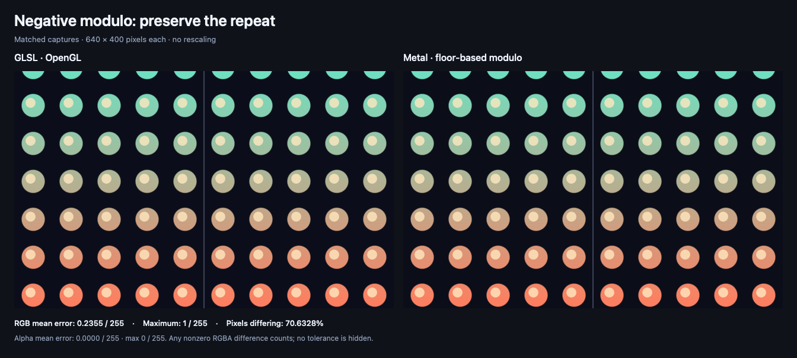
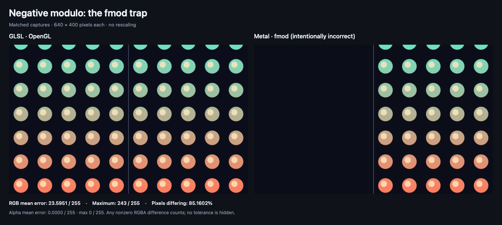

# Negative modulo

**Same dots, both sides of zero.**

This soft peach-to-mint pattern repeats across the screen. The thin center line marks where the horizontal coordinate changes from negative on the left to positive on the right.

It’s a small example of a conversion detail that can make half your pattern disappear.

## The conversion we want



GLSL is on the left. The Metal version on the right uses the same floor-based wrapping rule, so the dots can repeat on both sides of the center line.

The correct conversion stayed within **one RGB step out of 255** on the capture Mac. The exact measured differences are in [metrics.json](metrics.json). The capture includes the Metal function’s `half4` output rounding, so matching the wrapping rule does not promise identical pixels on every GPU.

## What goes wrong with a direct swap



Here, the Metal version deliberately substitutes `fmod`. It keeps a negative remainder for negative horizontal inputs, which moves those dots outside their cells. The positive side still repeats.

Both modulo captures use safe arithmetic and precise FP32 functions so the diagnostic tests the wrapping rule without relying on fast `fmod` accuracy. This version is a diagnostic example of the mistake. The normal app shader uses the correct helper. See [fmod-metrics.json](fmod-metrics.json) for the measured difference.

## Bring it into your app

After [installing the skill](../../README.md#get-it-set-up), paste this into Codex:

```text
Use $glsl-to-metal to add the negative modulo example to my app:
https://github.com/vicc/skills/tree/main/shader-skills/glsl-to-metal/examples/negative-modulo

Keep the repeating pattern intact on both sides of the center.
Help me change the colors and dot size, and explain where
the files go. Use the correct conversion from the example.
```

The supplied SwiftUI view is a fixed-time preview. Ask your agent to add animation scheduling if you want it to move in your app.

## Art-direct the dots

- “Make the dots smaller and give them more breathing room.”
- “Try lavender and butter yellow.”
- “Hide the center guide once we’ve checked the conversion.”

These are changes your agent can help implement, rather than built-in controls.

## Supported and tested versions

The example targets **iOS 17+ and macOS 14+**. See the shared [support and testing table](../README.md#supported-targets-and-actual-testing) for the actual build and capture environment, including what remains untested.

The images compare controlled GPU output. They do not establish your finished app’s appearance, performance, or behavior on every device.

<details>
<summary>Under the hood</summary>

- [GLSL](effect.glsl) calls `mod(x, 1.0)` with negative and positive horizontal coordinates.
- [Metal](effect.metal) uses the typed helper `x - y * floor(x / y)` and exposes `negativeModulo` as a stitchable `ShapeStyle`.
- [SwiftUIExamples.swift](../SwiftUIExamples.swift) includes `NegativeModuloExample(time:)`.

```swift
NegativeModuloExample(time: 1.25)
    .frame(width: 640, height: 400)
```

For example, GLSL `mod(-0.25, 1.0)` gives `0.75`, while `fmod(-0.25, 1.0)` gives `-0.25`. Both give `0.25` for the positive input `0.25`. This is why checking only positive coordinates can hide the problem.

The horizontal domain is centered on the image and scaled by 64. The positive divisor is always `1.0`. These finite inputs deliberately avoid zero divisors, infinities, NaNs, and extremely large quotients; this example does not define behavior for those cases. The time value shifts only the vertical pattern, keeping the horizontal sign boundary fixed.

The capture wrapper calls the actual stitchable entry point. Building with both `COMPARISON_CAPTURE=1` and `MODULO_USE_FMOD=1` enables the intentionally incorrect variant. Add the `.metal` file to your app without either definition; `MODULO_USE_FMOD` alone cannot select the diagnostic path.

SwiftUI coordinates are converted to the GLSL reference’s lower-left convention before the effect runs. No image texture is used, so this example does not test texture-loader orientation or transparency.

See the shared [capture methodology](../README.md#capture-conditions-and-measured-differences) and [reproduction instructions](../README.md#reproduce).

</details>
