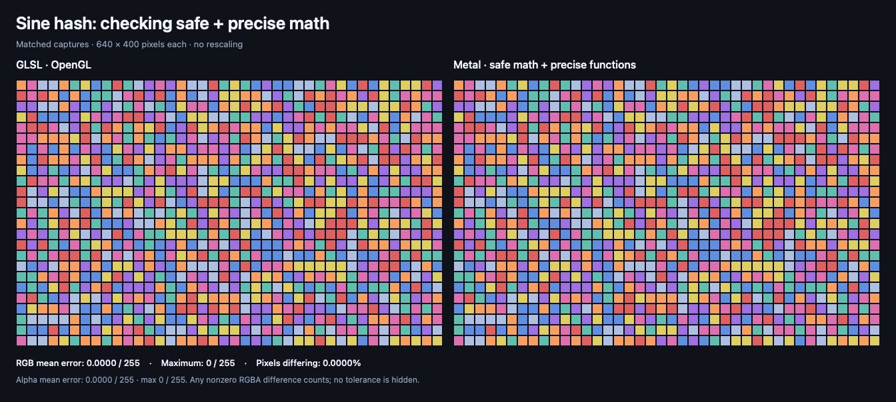
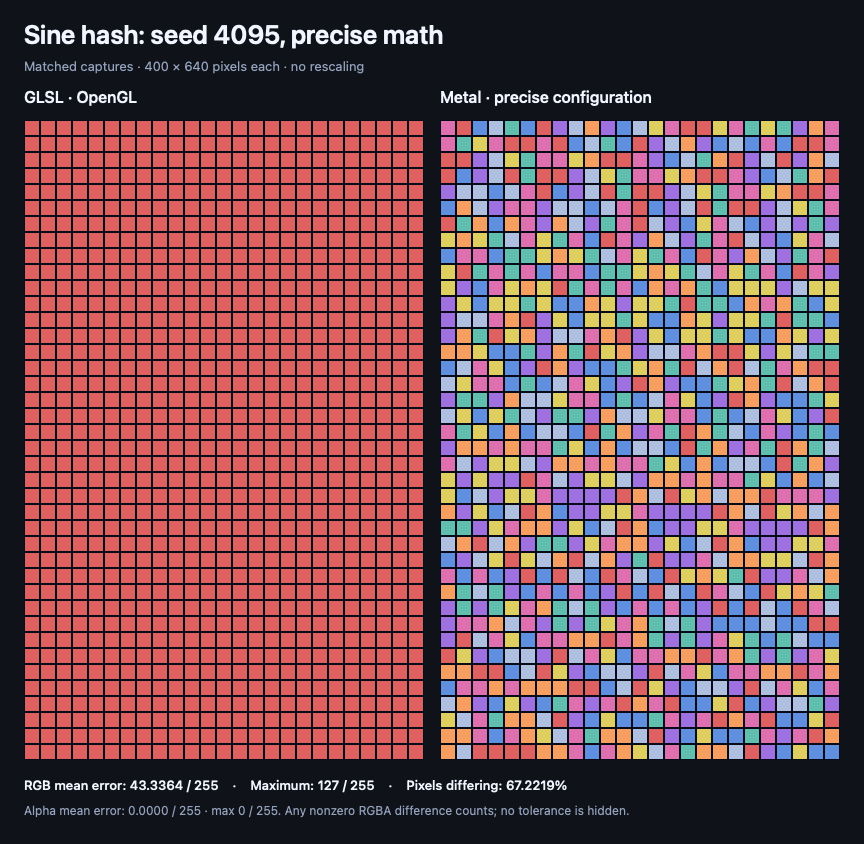
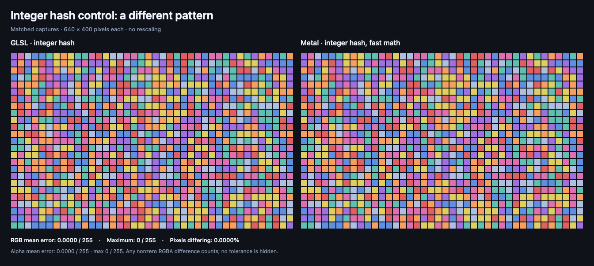

# Noise hashes

**Same recipe. Sometimes a different sprinkle.**

A colorful tile grid makes a subtle shader issue easier to spot. A tiny change in a calculation can send a tile to a different color, even when the GLSL and Metal code look almost identical.

This example keeps the same sine-based noise recipe and compares two Metal math settings. It also includes an optional integer-based version that creates a different pattern.

## What happened on this Mac

At the default seed, both Metal settings matched the GLSL image pixel for pixel. A larger-seed check told a different story: fast math still matched, while safe and precise math changed many tile colors.

That does not make fast math universally more accurate. It shows that the most precise result is not always the closest match to a particular GLSL renderer. These are observations from one GPU and compiler setup, and the palette can hide small differences in the underlying noise values.

## Spot the difference

### Original noise, fast Metal math


GLSL is on the left. Metal using fast math is on the right. Each tile gets its color from the same source formula, so changed colors show where the rendered results diverged.

[Measured differences →](metrics.json)

### Original noise, safe and precise Metal math



The formula stays the same. This time, Metal disables unsafe floating-point optimizations and uses its precise 32-bit math functions.

This is a useful comparison setting, not a promise of identical output. Precise math can still differ from the GLSL implementation on the same or another GPU. Check the measured result before deciding whether it helps your effect.

[Measured differences →](precise-metrics.json)

### A larger-seed check



Here we keep the same shader code and change the input: a seed of **4095** at **400 × 640 pixels**. Safe and precise Metal math now produces visibly different tiles: **67.22% of pixels changed**, with a maximum RGB difference of **127 out of 255** on this Mac. The [fast-math comparison](large-seed-fast-comparison.png) matched the GLSL image for this same input.

The seed creates large sine inputs, where fast sine has weaker accuracy guarantees. Use this as a stress check, not a verdict about which renderer is mathematically correct. Smaller portrait seeds of **0 and 17** matched in both configurations; all results are kept in the [capture manifest](../capture.json).

[Large-seed precise results →](large-seed-precise-metrics.json)

### An optional integer-based pattern



This version uses matching 32-bit integer operations to choose the tile colors. It avoids the sine calculation that makes the original pattern sensitive to tiny precision differences.

**It changes the artwork.** Use it when you can choose a new noise pattern. Ask before replacing the hash in an effect whose exact look you want to preserve. Matching this capture does not establish identical output for every device or input.

[Measured differences →](integer-metrics.json)

The integer control also matched at the larger seed. [See that comparison →](large-seed-integer-comparison.png)

## Bring it into your app

After [installing the skill](../../README.md#get-it-set-up), paste this into Codex:

```text
Use $glsl-to-metal to explore the noise hashes example:
https://github.com/vicc/skills/tree/main/shader-skills/glsl-to-metal/examples/noise-hash

Show me the original noise and the optional integer-based
pattern in my app. Explain any visual differences.

Help me adjust the palette and tile size. Keep the original
hash unless I choose a different pattern.
```

The supplied SwiftUI view holds time at a fixed value so the pattern is easy to compare. If you animate its time input, the seed changes at whole seconds. It is a stepped change, not smooth motion.

## What’s included

- Matching GLSL and Metal source for the original sine hash.
- Fast and safe/precise Metal captures of that same source.
- An explicit integer-hash alternative in both shader languages.
- A small SwiftUI view and measured differences for each comparison.

The palette has eight colors. Small changes to the noise value can stay inside the same color band, so matching colors do not prove the underlying floating-point values are identical. All pixels are opaque; this example does not test transparency.

## Supported and tested versions

The app-facing example targets **iOS 17+ and macOS 14+**. The shared [testing table](../README.md#supported-targets-and-actual-testing) and [capture manifest](../capture.json) record the actual toolchain, hardware, and completed checks.

GPU comparisons are offscreen captures. They do not establish finished-app appearance, performance, iOS execution, or behavior on the minimum OS releases.

<details>
<summary>Under the hood</summary>

The integer control adapts Chris Wellons’s [`lowbias32` mixer from Hash Function Prospector](https://github.com/skeeto/hash-prospector/blob/396dbe235c94dfc2e9b559fc965bcfda8b6a122c/README.md#two-round-functions), released into the public domain under the [Unlicense](https://github.com/skeeto/hash-prospector/blob/396dbe235c94dfc2e9b559fc965bcfda8b6a122c/UNLICENSE). The tile layout, palette, shader integration, and comparison tooling are original work under this repository’s [MIT license](../../../../LICENSE).

- [GLSL](effect.glsl) uses the common `fract(sin(dot(...)) * largeConstant)` form by default.
- [Metal](effect.metal) keeps that formula and exposes `noiseHash(position, bounds, time)` as a stitchable `ShapeStyle`.
- [SwiftUIExamples.swift](../SwiftUIExamples.swift) provides `NoiseHashExample(time:)`.
- Both sources accept `NOISE_INTEGER_HASH=1` as an explicit compile-time choice for the alternative. It is off by default.

```swift
NoiseHashExample(time: 1.25)
    .frame(width: 640, height: 400)
```

Add the Metal file to your app target without `COMPARISON_CAPTURE`. Keep that define for the capture harness only. SwiftUI positions and tile sizes use the same user-space units. The published capture uses one unit per pixel and 16-unit tiles. The Y conversion matches GLSL’s lower-left fragment coordinates.

The baseline capture uses time 1.25 (seed 1), and the portrait stress capture uses time/seed 4095. All captured inputs are finite. Cell indices are clamped to `0...65535` and the time-derived seed to `0...4095` before unsigned conversion. Fractional time is discarded. The integer alternative uses unsigned 32-bit multiplication, XOR, and shifts with wraparound semantics; its top 24 bits are converted to a float and scaled by an exact power of two. The palette uses exactly representable binary fractions so palette math is not another source of divergence.

The fast capture uses `-fmetal-math-mode=fast -fmetal-math-fp32-functions=fast`. The precise capture uses `-fmetal-math-mode=safe -fmetal-math-fp32-functions=precise`. These are compiler options for the recorded toolchain, not SwiftUI view modifiers. Inspect your project’s actual Metal build settings before assuming the app uses the same mode. No source call forces `precise::sin`, so the compiler options control the comparison.

The Metal specification gives fast sine a tight absolute-error bound only over `[-pi, pi]`, with larger error outside that interval. This hash intentionally produces angles outside it. Large finite inputs are not declared undefined, but the small-angle bound cannot be applied to this test. See section 8.4, Table 8.2 of the [Metal language specification](https://developer.apple.com/metal/Metal-Shading-Language-Specification.pdf).

The GLSL reference on the capture Mac reports an OpenGL implementation backed by Metal. This is useful for checking the translation on that setup, but is not an independent test across GPU vendors.

The capture calls the actual stitchable function, including its `half4` result. The comparison measures final RGBA8 pixels, not the raw hash values. See [the shared capture methodology](../README.md#capture-conditions-and-measured-differences) for the measurement limits.

</details>
