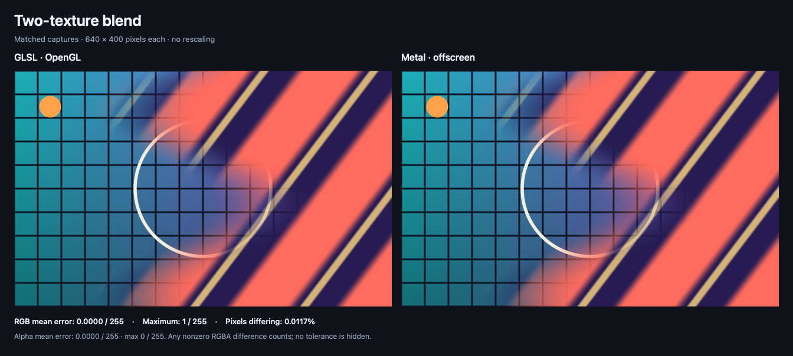

# GLSL → Metal examples

Three original examples with real GPU-rendered output at matching inputs. Each comparison places the GLSL capture on the left and the Metal capture on the right, without resizing either image.

| Example | Integration | What it demonstrates |
| --- | --- | --- |
| [Aurora ribbons](aurora-ribbons/) | SwiftUI `ShapeStyle` | Procedural color, aspect correction, Y origin, and `half4` output. |
| [Ripple distortion](ripple-distortion/) | SwiftUI `distortionEffect` | Destination-to-source mapping, point/pixel units, and bounded sampling. |
| [Two-texture blend](two-texture-blend/) | Metal render pipeline + SwiftUI bridge | Two independent textures, sampler matching, and a native macOS/iOS renderer. |

## Supported targets and actual testing

**The example app code targets iOS 17+ and native macOS 14+.** These are declared deployment targets, not a claim that every intervening OS/device combination has been executed. SwiftUI's core shader APIs start at those versions; optional precompilation needs iOS 18/macOS 15. [Apple Shader](https://developer.apple.com/documentation/swiftui/shader), [precompilation](https://developer.apple.com/documentation/swiftui/shader/compile(as:)).

| Platform / version | Build verification | Runtime / visual verification |
| --- | --- | --- |
| iOS 17 minimum, arm64 | All app-facing Swift compiled in Swift 6 mode; all production Metal shaders compiled and linked for iOS 17. | Not run on iOS 17, a newer iOS device, or an iOS simulator. |
| macOS 14 minimum, arm64 | All app-facing Swift compiled in Swift 6 mode; all production Metal shaders compiled and linked for macOS 14. | Not run on macOS 14 itself. |
| macOS 26.7.1, Apple M3 Max | Capture tools compiled and ran. | All three GLSL/Metal captures rendered; SwiftUI fill/distortion bindings precompiled on this Mac. |
| Intel Mac / Mac Catalyst / other Apple platforms | Not checked. | Not checked. |

The recorded toolchain is **Xcode 27.1**, **Swift 6.4**, **macOS SDK 27.0**, and **iPhoneOS SDK 27.1**. This records the tested setup; it does not establish Xcode 27.1 as the minimum toolchain. [capture.json](capture.json) records the actual capture environment, source/image hashes, and results.

These images compare native GLSL/OpenGL with **offscreen Metal**, not end-to-end SwiftUI window screenshots. The capture wrappers call the actual stitchable functions or the shared production fragment implementation. SwiftUI compositing/color management, physical display migration, live UI resizing, and performance are not established by these captures. OpenGL is used only to run the GLSL reference on this Mac; it is not the implementation recommended for Apple apps, and these are not WebGL/browser tests.

## Aurora ribbons


[GLSL source](aurora-ribbons/effect.glsl) · [Metal source](aurora-ribbons/effect.metal) · [SwiftUI examples](SwiftUIExamples.swift) · [Notes](aurora-ribbons/README.md)

## Ripple distortion


[GLSL source](ripple-distortion/effect.glsl) · [Metal source](ripple-distortion/effect.metal) · [SwiftUI examples](SwiftUIExamples.swift) · [Notes](ripple-distortion/README.md)

## Two-texture blend



[GLSL source](two-texture-blend/effect.glsl) · [Metal source](two-texture-blend/effect.metal) · [SwiftUI/MetalKit view](two-texture-blend/TwoTextureBlendView.swift) · [Notes](two-texture-blend/README.md)

## Capture conditions and measured differences

Published captures use **640 × 400 pixels**, **time = 1.25 seconds**, one user-space unit per pixel, opaque inputs/output, and RGBA8 UNORM targets. Blending, MSAA, and dithering are disabled. Textures use linear filtering, clamp-to-edge, no mipmaps, and no sRGB decoding; both backends intentionally operate on the same numeric RGB values. Raw capture PNGs are tagged sRGB for display without transforming the stored samples.

| Example | Mean absolute RGB error, 0–255 units | Maximum RGB error | Pixels with any channel difference |
| --- | ---: | ---: | ---: |
| Aurora ribbons | 0.00428125 | 1 / 255 | 1.271484% |
| Ripple distortion | 0.0000026042 | 1 / 255 | 0.000781% |
| Two-texture blend | 0.0000403646 | 1 / 255 | 0.011719% |

Alpha is identical in all captures. Every nonzero channel difference counts; there is no hidden tolerance. Aurora also includes the expected rounding from its `half4` result. The two images look closely matched, but they are **not byte-identical**. These measurements apply to the recorded inputs and hardware, not every possible parameter value or GPU.

An additional 400 × 640 check at time 3.75 seconds also stayed within one RGB level per channel for all three examples. The published gallery remains the landscape capture above.

## Reproduce

On a Mac with a Metal GPU, a working OpenGL context, a full Xcode installation with the Metal toolchain, and Python 3, run from the repository root:

```sh
bash shaders/glsl-to-metal/examples/tools/render.sh
bash shaders/glsl-to-metal/examples/tools/validate.sh
```

`render.sh` regenerates the original texture fixtures, builds the capture tools, compiles and executes both shader versions, and writes the PNGs, metrics, and capture manifest. It overwrites those generated example assets. `validate.sh` separately compiles app-facing Swift and production Metal for iOS 17/macOS 14, then checks SwiftUI shader bindings on the current Mac when macOS 15+ precompilation is available. The scripts do not install or launch an app. Build products remain in ignored `.build/`.

The GLSL files contain `mainImage` bodies. The reference tool injects `#version 330 core`, `iResolution` as `vec2`, `iTime` as `float`, and two `sampler2D` uniforms. When adapting to Shadertoy's `vec3 iResolution`, use `.xy` in the corresponding expressions.

The Metal files compile normally into an app target. `COMPARISON_CAPTURE=1` adds only the offscreen capture entry points; **do not set it in an app target**. The normal app-facing functions have unique names and can share one Metal library. [SwiftUIExamples.swift](SwiftUIExamples.swift) provides fixed-time views and an optional animated Aurora view. Add the supplied PNGs to your app resources for the texture examples.

The output from [compare.swift](tools/compare.swift) preserves the native capture pixels and measures raw PNG channel values. It does not compare perceptual appearance, color-managed display output, or frame timing. The source shaders, generated textures, tools, and images are original examples under the repository's [MIT license](../../../LICENSE).
