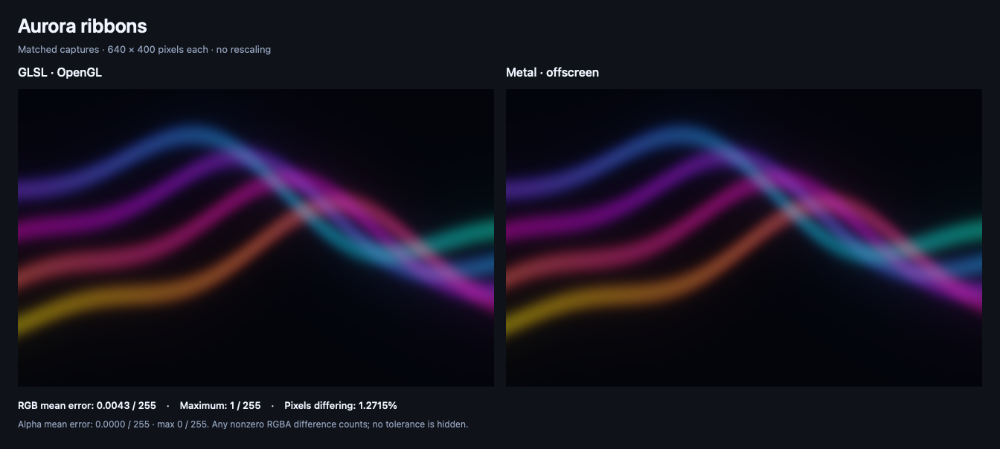

# Aurora ribbons

**Soft color, dreamy energy.**



Four flowing ribbons create an animated background entirely through code. No images to source or upload.

Try it behind a welcome screen, a title, or anywhere you want a little atmosphere.

## Bring it into your app

After [installing the skill](../../README.md#get-it-set-up), paste this into Codex:

```text
Use $glsl-to-metal to add the aurora ribbons example to my app:
https://github.com/vicc/skills/tree/main/shaders/glsl-to-metal/examples/aurora-ribbons

Start with the included animated version. Help me adjust
the colors and speed, and explain where each file goes.

Keep the effect subtle enough for text to stay readable.
```

The example includes a fixed-time preview and an animated version. The animation pauses when the view disappears, the app becomes inactive, or Reduce Motion is enabled.

## Art-direct the glow

Try asking:

- “Use lavender and peach instead of the current palette.”
- “Slow it down so the movement feels almost still.”
- “Leave more quiet space behind my headline.”

These are changes your agent can help implement, rather than controls already built into the example.

## What’s included

- The original GLSL and converted Metal code.
- A small SwiftUI example.
- Side-by-side captures and measured differences.

The largest observed RGB difference was **one step out of 255**. This example is fully opaque, so it doesn’t test transparency.

## Supported and tested versions

| Platform | What’s verified |
| --- | --- |
| **iOS 17+ target** | The example compiled for iOS 17. Not run on an iPhone, iPad, or simulator. |
| **macOS 14+ target** | The example compiled for macOS 14. GPU captures ran on macOS 26.7.1, Apple M3 Max. |

The tested build setup used **Xcode 27.1**. Execution on the minimum OS releases, Intel Macs, and Mac Catalyst remains untested.

[Full testing details →](../README.md#supported-targets-and-actual-testing)

The comparisons show controlled GPU output. Your finished app’s appearance and performance still need to be checked.

<details>
<summary>Under the hood</summary>

Four animated procedural ribbons, implemented as a SwiftUI shader fill. No textures or source view are required.

- [GLSL](effect.glsl) uses lower-left pixel coordinates and aspect-corrects by viewport height.
- [Metal](effect.metal) exposes `auroraRibbons` as a stitchable `ShapeStyle`. It flips SwiftUI's top-left Y coordinate before calling the same effect math. Because the coordinates are normalized by height, a uniform point-to-pixel scale cancels out.
- [SwiftUIExamples.swift](../SwiftUIExamples.swift) includes `AuroraRibbonsExample(time:)` and `AnimatedAuroraExample()`. Add this `.metal` file to the app target without `COMPARISON_CAPTURE`.

```swift
AuroraRibbonsExample(time: 1.25)
    .frame(width: 640, height: 400)
```

The animated wrapper pauses when hidden, inactive, or under Reduce Motion. Both time frequencies repeat after `40 * pi` seconds, so the wrapper reduces that period before converting to Float. Recreating the view's identity restarts it.

The capture calls the actual stitchable function, including its `half4` output rounding. The largest observed channel difference is 1/255; see [metrics.json](metrics.json). All output pixels are opaque, so this example does not test transparency.

**Targets:** iOS 17+ / native macOS 14+. Both minimum targets compiled; actual GPU captures ran on macOS 26.7.1, Apple M3 Max. No iOS runtime or minimum-OS runtime was tested. See the shared [support/testing table](../README.md#supported-targets-and-actual-testing) and [capture methodology](../README.md#capture-conditions-and-measured-differences).

</details>
