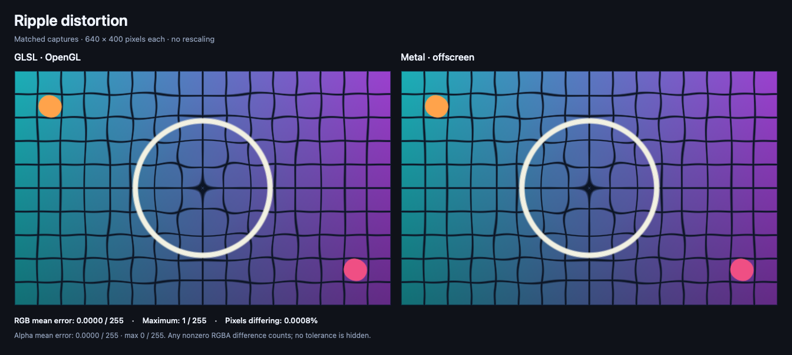

# Ripple distortion

**Give your images a little movement.**



A wave bends the image around its center, creating a water-like ripple.

The included grid makes the movement easy to see. Its colored corner markers also help catch an image that accidentally flips during conversion.

## Try the ripple

After [installing the skill](../../README.md#get-it-set-up), paste this into Codex:

```text
Use $glsl-to-metal to add the ripple distortion example to my app:
https://github.com/vicc/skills/tree/main/shaders/glsl-to-metal/examples/ripple-distortion

Start with the included grid image so I can check the effect.
Then help me replace it with my own artwork.

Make the ripple strength adjustable and explain how to
preview it in Xcode.
```

The included view shows a chosen moment in the ripple. Ask your agent to connect it to animation when you’re ready.

## Find the right amount of motion

Try asking:

- “Make the ripple barely noticeable.”
- “Keep the edges calmer than the center.”
- “Animate one ripple when someone taps the image.”

Touch interaction isn’t included in the starting example. Your agent would need to add it.

## What’s included

- The original GLSL and converted Metal code.
- A SwiftUI example and a sample image.
- Side-by-side captures and measured differences.

The largest observed RGB difference was **one step out of 255**. Check the effect on your intended screen size, since movement measured in screen points can cover different numbers of pixels on different displays.

## Supported and tested versions

| Platform | What’s verified |
| --- | --- |
| **iOS 17+ target** | The example compiled for iOS 17. Not run on an iPhone, iPad, or simulator. |
| **macOS 14+ target** | The example compiled for macOS 14. GPU captures ran on macOS 26.7.1, Apple M3 Max. |

The tested build setup used **Xcode 27.1**. Execution on the minimum OS releases, Intel Macs, and Mac Catalyst remains untested.

[Full testing details →](../README.md#supported-targets-and-actual-testing)

The comparisons show controlled GPU output. Your finished app’s appearance and performance still need to be checked.

<details>
<summary>Under the hood</summary>

A radial wave displaces sampling positions in an asymmetric grid image. The colored corner markers make an accidental Y flip easy to spot.

- [GLSL](effect.glsl) calculates the source texture coordinate for each destination pixel.
- [Metal](effect.metal) exposes that same inverse mapping as `rippleDistortion`, a SwiftUI `distortionEffect` returning a source position.
- [SwiftUIExamples.swift](../SwiftUIExamples.swift) provides `RippleDistortionExample(image:time:amplitude:)`. Add this `.metal` file to the app target, and add [grid.png](../assets/grid.png) to an image asset named `ComparisonGrid`.

```swift
RippleDistortionExample(image: Image("ComparisonGrid"), time: 1.25, amplitude: 7)
    .frame(width: 640, height: 400)
```

The wave's displacement is bounded by `abs(amplitude)` on each axis, which supplies `maxSampleOffset`. The edge fade reduces displacement near the boundary. In SwiftUI, amplitude and the 30-unit edge fade are in points. In the comparison harness, one user-space unit equals one pixel. To match physical pixels at 2×/3×, scale both these distances and the rendered view dimensions accordingly; the fixed captures do not establish Retina pixel parity.

The capture calls the actual stitchable position function and samples an opaque texture with linear/clamp sampling. SwiftUI's own layer rasterization and edge behavior are outside this comparison. The largest observed channel difference is 1/255; see [metrics.json](metrics.json).

**Targets:** iOS 17+ / native macOS 14+. Both minimum targets compiled; actual GPU captures ran on macOS 26.7.1, Apple M3 Max. No iOS runtime or minimum-OS runtime was tested. See the shared [support/testing table](../README.md#supported-targets-and-actual-testing).

</details>
